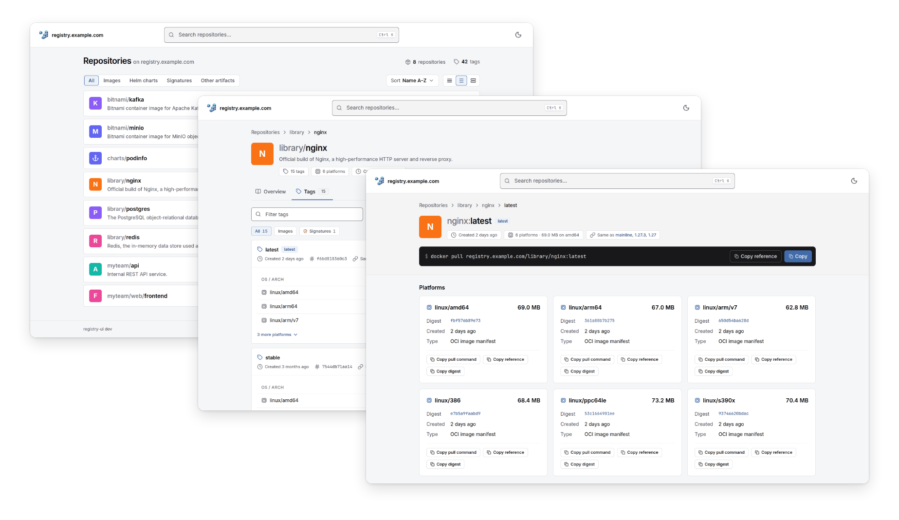

<p align="center">
  <picture>
    <source media="(prefers-color-scheme: dark)" srcset=".github/assets/wordmark-dark.svg">
    
  </picture>
</p>

<p align="center">See what's in your container registry, including your pull-through cache.</p>

<p align="center">
  <a href="https://github.com/Ahhhh-man/registry-ui/actions/workflows/ci.yml"></a>
  <a href="https://github.com/Ahhhh-man/registry-ui/pkgs/container/registry-ui"></a>
  <a href="go.mod"></a>
  <a href="LICENSE"></a>
</p>



You run a [CNCF Distribution](https://distribution.github.io/distribution/) registry (`registry:2` or `registry:3`) and want to know what's in it. Maybe it's a pull-through cache and you want to know what it has actually cached. The registry has no UI, and `curl`ing `/v2/_catalog` gets old fast.

registry-ui shows you every repository, tag and platform, with digests, sizes and created dates. You can search, sort, filter by type (images, Helm charts, signatures, other artifacts) and copy a pull command for any tag or platform.

It's read-only. It doesn't push, manage users, replicate or scan, so it won't replace Harbor or Zot. It's one static binary in an image under 20 MB, and it sits next to your registry doing nothing until someone opens it.

## Quick start

Save this as `compose.yaml` and run `docker compose up -d`:

```yaml
services:
  registry:
    image: registry:3
    ports: ["5000:5000"]
    volumes: ["registry-data:/var/lib/registry"]

  registry-ui:
    image: ghcr.io/ahhhh-man/registry-ui:latest
    ports: ["8080:8080"]
    environment:
      REGISTRY_UI_REGISTRY_URL: http://registry:5000 # how the UI reaches the registry
      REGISTRY_UI_PULL_URL: localhost:5000 # what people type after `docker pull`
    healthcheck:
      test: ["CMD", "/registry-ui", "healthcheck"]

volumes:
  registry-data:
```

The same image is on Docker Hub as `ahhhhman/registry-ui`, if you'd rather pull from there.

Push something, then open <http://localhost:8080>:

```sh
docker pull busybox
docker tag busybox localhost:5000/busybox
docker push localhost:5000/busybox
```

The UI talks to the registry from the server. Docker clients still talk to the registry directly and browsers never do, so there's no CORS to set up. The UI starts even if the registry isn't up yet. The healthcheck only checks the UI itself, so a registry outage won't restart it.

## Configuration

Everything is an environment variable. There are no config files or flags, and an empty value counts as unset.

| Variable | Default | What it does |
|---|---|---|
| `REGISTRY_UI_REGISTRY_URL` | required | The registry's base URL, e.g. `http://registry:5000`. Optional in storage mode. |
| `REGISTRY_UI_PULL_URL` | host of `REGISTRY_UI_REGISTRY_URL` | The `host[:port]` shown in pull commands, e.g. `registry.example.com`. |
| `REGISTRY_UI_TITLE` | the pull URL | Name shown in the header and the page title. |
| `REGISTRY_UI_LISTEN` | `:8080` | Address to listen on. |
| `REGISTRY_UI_BASE_PATH` | `/` | Serve under a sub-path, e.g. `/registry/`. |
| `REGISTRY_UI_SECRET` | random on each start | Key for the session cookie. Set it to keep people signed in across restarts. |
| `REGISTRY_UI_REGISTRY_INSECURE` | `false` | Skip TLS verification when talking to the registry. |
| `REGISTRY_UI_LOG_LEVEL` | `info` | `debug`, `info`, `warn` or `error`. |
| `REGISTRY_UI_STORAGE_PATH` | unset | Read the registry's storage folder directly instead of its API. See [Pull-through caches](#pull-through-caches). |

If a value is invalid, the UI won't start, and it prints one line per problem.

### TLS and reverse proxies

The UI serves plain HTTP, so put TLS on your reverse proxy. Pass the original `Host` (or `X-Forwarded-Host`) and `X-Forwarded-Proto` through. Sign-in needs them, and they're how the session cookie gets marked `Secure`. Caddy does this by default:

```
registry.example.com {
	reverse_proxy registry-ui:8080
}
```

To serve the UI under a sub-path, set `REGISTRY_UI_BASE_PATH=/registry/` and forward the path as it is. Don't strip the prefix, because the UI expects to see it.

```
example.com {
	handle /registry/* {
		reverse_proxy registry-ui:8080
	}
}
```

### Registries with a private CA

The image trusts the usual public CAs. If your registry's certificate comes from your own CA, mount the CA certificate into a folder and point `SSL_CERT_DIR` at it. Or point `SSL_CERT_FILE` at a bundle that includes it, which replaces the built-in bundle. For a quick test, `REGISTRY_UI_REGISTRY_INSECURE=true` skips verification altogether.

## Authentication

The UI has no users of its own. It does whatever the registry does:

- If the registry allows anonymous reads, there's no sign-in.
- If the registry asks for credentials, the UI shows a sign-in form. It checks what you enter against the registry and sends it with every request. Basic auth and token servers both work.
- Your credentials are sealed (AES-GCM) in an `HttpOnly` cookie that lasts 12 hours. Nothing is written to disk.
- Without `REGISTRY_UI_SECRET`, the UI picks a new key every time it starts, so a restart signs everyone out. Set it to any long random string, e.g. `openssl rand -hex 32`.

## Pull-through caches

If your registry is a pull-through cache (`REGISTRY_PROXY_REMOTEURL`), use storage mode. Browsing a cache through its API asks the upstream for every tag list, and clicking a tag that isn't cached yet makes the registry pull and store it. Both eat into your upstream rate limit, and you end up looking at the upstream's tags instead of your cache.

In storage mode the UI reads the registry's storage folder directly, mounted read-only. It never sends the registry or the upstream a single request, so you see exactly what's cached. For a multi-arch image, you only see the platforms someone has actually pulled.

```yaml
services:
  registry:
    image: registry:3
    ports: ["5000:5000"]
    environment:
      REGISTRY_PROXY_REMOTEURL: https://registry-1.docker.io
    volumes: ["cache-data:/var/lib/registry"]

  registry-ui:
    image: ghcr.io/ahhhh-man/registry-ui:latest
    ports: ["8080:8080"]
    environment:
      REGISTRY_UI_STORAGE_PATH: /var/lib/registry
      REGISTRY_UI_PULL_URL: localhost:5000 # required when REGISTRY_UI_REGISTRY_URL is unset
    volumes: ["cache-data:/var/lib/registry:ro"]
    healthcheck:
      test: ["CMD", "/registry-ui", "healthcheck"]

volumes:
  cache-data:
```

Pull something through the cache (`docker pull localhost:5000/library/busybox`) and it shows up in the UI.

**Storage mode skips the registry's auth.** Anyone who can reach the UI sees everything in the cache. If that's a problem, put the UI behind your reverse proxy's auth.

Some limits:

- It only works with the registry's `filesystem` storage driver. S3, GCS, Azure and the rest aren't supported.
- The UI has to see the same folder the registry writes to, so run both on the same host or give them a shared volume.
- An empty folder is fine. The registry creates its layout on the first pull.

## Supported registries

[CNCF Distribution](https://distribution.github.io/distribution/) (`registry:2` and `registry:3`) is the one that's supported and tested. Other registries that implement the OCI distribution API and `/v2/_catalog` should work, but nobody has tested them. GHCR, Docker Hub and ECR restrict or leave out `_catalog`, so don't expect them to work.

## No telemetry

The UI only ever talks to the registry you point it at. No telemetry, no update checks, no CDNs. Fonts, scripts and styles are all embedded in the binary.

## Development

You need [Nix](https://nixos.org) with flakes. The dev shell has Go, the linters, the Tailwind CLI and [Task](https://taskfile.dev).

```sh
nix develop
task dev     # serves on :8080, templates and CSS reload on refresh
task test
task lint
task build   # ./registry-ui
task image   # builds the container image with Nix and loads it into Docker
```

With [direnv](https://direnv.net) and [nix-direnv](https://github.com/nix-community/nix-direnv), run `direnv allow` once and the dev shell loads whenever you `cd` into the repo.

`task dev` needs `REGISTRY_UI_REGISTRY_URL` pointing at a registry. To work on the UI without one, build with `-tags fake`. That serves built-in sample data. The URL still has to be set, but it isn't used:

```sh
REGISTRY_UI_REGISTRY_URL=http://unused go run -tags fake .
```

The CSS is built from `web/tailwind.css` into `internal/ui/static/app.css` with the Tailwind standalone CLI (`task css`, or watched by `task dev`). The output is committed, so building and running the UI needs only Go, with no Node or Tailwind. CI checks that the committed file is up to date, so run `task css` before you commit a template or style change.

No Nix? The `Dockerfile` builds an equivalent image: `docker build -t registry-ui .`. The published image is the Nix one.

## License

[MIT](LICENSE)
